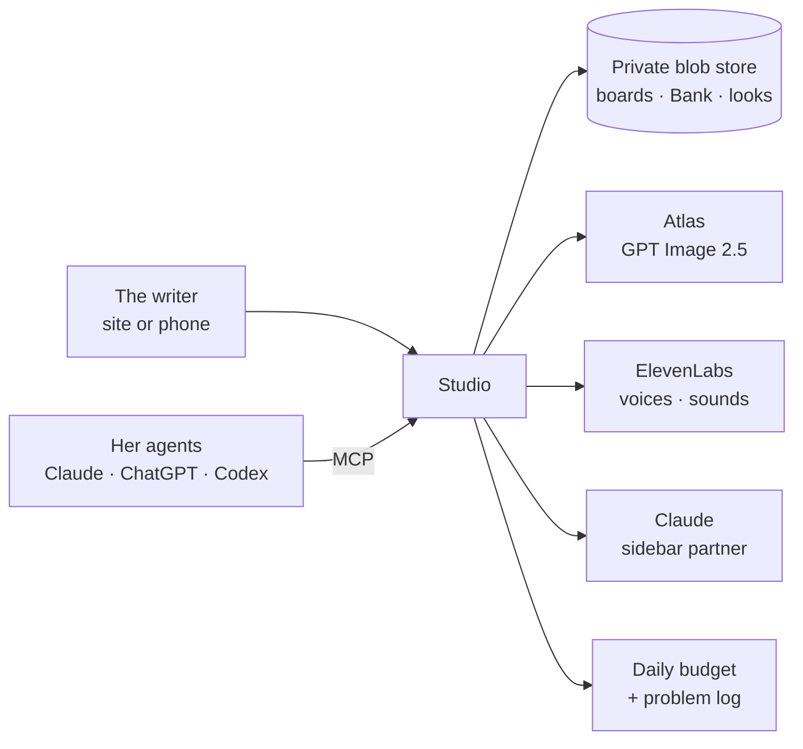

<p align="center"></p>

<h1 align="center">Writers' Room Studio</h1>
<p align="center"><b>A storyboard room where the writer stays in charge, and her agents do the legwork.</b></p>
<p align="center">


</p>

Built for one writer making a vertical comedy series. She had scripts, locked characters and a head full of direction, and every change had to go through somebody else. Now she tells an agent what she sees, from her phone if she wants, and it lands on the board.

## What it does

| | |
|---|---|
| **The rail** | Shots hang in order. Drag them, change them, draw them, play them back as an animatic with voices and captions. |
| **Her words stay hers** | A line that isn't word for word in the script gets stamped **Proposed** by the server, whoever wrote it. |
| **Only she says yes** | Her yes and her choice of a character's look work only on her own link. |
| **Draw 3, pick 1** | Every picture is drawn from the current character looks and rooms. All takes are kept. |
| **Her look** | She describes a change and draws options. When she picks one, every new picture uses it, and shots showing the old look get flagged. |
| **The Bank** | Sounds, reference pictures, notes and a range of faces she directs. Upload, record on a phone, or describe one and have it made. |
| **The Recipe** | A fill-in-the-blank for a scene, so she thinks in ingredients and nothing gets lost. |
| **Her agents** | One line installs the studio into Claude, ChatGPT, Claude Code or Codex over MCP, with a manual on how the show works. |

## How it fits together



- **Saves can't collide.** Boards use conditional writes, so two people or agents can't overwrite each other.
- **Money is held before a paid call starts**, so simultaneous requests can't pass the daily cap together.
- **Problems reach the operator**, not the writer's friends. Failures log themselves, and agents have a `report_problem` tool.
- **Refusals stay refused.** A refused picture is never retried on a less filtered model, and the server blocks sexual requests outright.

## Run it

```bash
npm install
cp .env.example .env.local   # leave it empty to run locally with file storage
npm run dev                  # http://localhost:3456
npm test
```

Put your own show in [`data/`](data/README.md). This repo ships with a tiny sample script, and the real show's scripts and pictures are not here.

For production, set the variables in `.env.example`. Each person gets a secret link (`/?k=<token>`) that stays signed in on that device.

## For agents

Give an agent the install link at `/m/<token>`. It explains how to connect, how to confirm it worked, and how to work. The MCP endpoint is `/m/<token>/mcp`.

| Look | Board | Make | Keep |
|---|---|---|---|
| `start_here` `list_episodes` `read_episode` `read_bank` `read_recipe` `list_looks` `show_picture` | `add_shot` `update_shot` `move_shot` `remove_shot` `pick_take` `pin_to_shot` `give_yes` | `draw_shot` `draw_look` `make_face` `make_sound` | `add_note` `add_to_bank` `set_look` `set_recipe` `report_problem` |

## Status

In daily use by one writer. Built fast and reviewed as it went. Filming approved shots into video still happens outside the studio.
