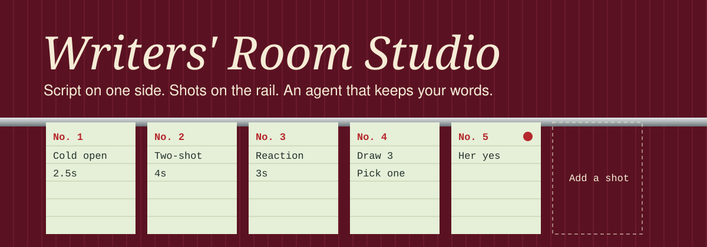
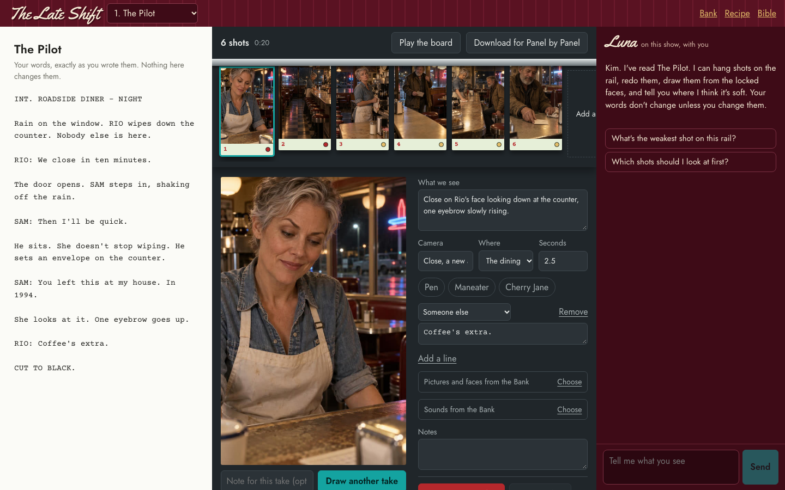
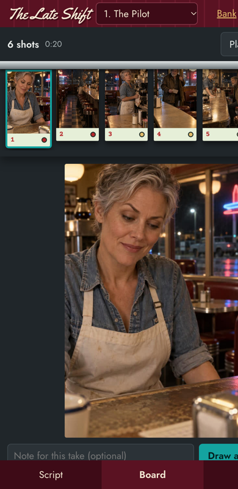
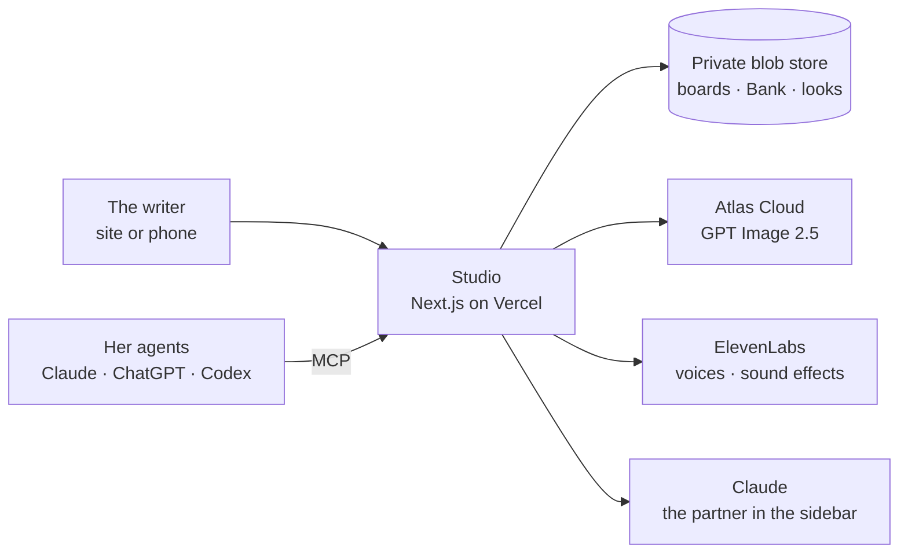

<p align="center"></p>

<h3 align="center">A storyboard room where the writer stays in charge,<br>and her agents do the legwork.</h3>

<p align="center">


</p>

<p align="center"><a href="#the-tour">The tour</a> · <a href="#talk-to-it">Talk to it</a> · <a href="#what-it-wont-let-happen">Guardrails</a> · <a href="#how-it-fits-together">Architecture</a> · <a href="#run-it">Run it</a></p>

---

A writer had sixteen scripts, three characters and a head full of direction. Every change had to go through the person running the AI tools. So we gave her the room.

She opens one private link. Her script is on the left, the shots hang on a steel order rail, and an agent sits on the right. She says what she sees. If she'd rather work from her own Claude or ChatGPT, in the car if she wants, one pasted line connects them.

The sample show in these pictures comes with the repo, drawn with made-up people.

<p align="center"></p>

## The tour

<table>
<tr>
<td width="62%" valign="top">

**The rail.** Shots hang in order, like tickets in a kitchen. Drag them, change them, draw them. Play the board runs the episode with pictures, voices, sounds and captions before anyone pays to film it.

**Draw 3, pick 1.** Every picture starts from the current character looks and the room. All takes are kept.

**Her look.** "Too thin, harder, more punk." She draws options, and when she picks one, every new picture uses it and any shot showing the old look gets flagged.

**The Bank.** Sounds, reference pictures, notes and a range of faces she directs. Upload them, record one on a phone, or describe one and have it made.

**The Recipe.** A fill-in-the-blank for a scene, so she can think in ingredients and nothing gets lost.

</td>
<td width="38%" align="center"></td>
</tr>
</table>

## Talk to it

Paste one line to any agent:

```text
Read https://your-studio/m/<token> and follow it to connect yourself to my studio. Tell me when it works.
```

It installs itself, checks that it worked, and reads a manual on how the show runs. Then:

```text
You:   Board the first scene, cold open first. Sam looks like he drove all night.
Agent: Six shots on the rail, with your exact lines. Draw them?
You:   Draw the cold open, give me 3.
Agent: [three pictures] Take 2 has the eyebrow.
You:   Yes on that one. And I need a sound of rain on a diner window.
Agent: Your yes is on it. The rain is in the Bank and pinned to shot 2.
```

Tested with real Claude and ChatGPT chats, Claude Code and Codex.

| Look | Board | Make | Keep |
|---|---|---|---|
| `start_here` `list_episodes` `read_episode` `read_bank` `read_recipe` `list_looks` `show_picture` | `add_shot` `update_shot` `move_shot` `remove_shot` `pick_take` `pin_to_shot` `give_yes` | `draw_shot` `draw_look` `make_face` `make_sound` | `add_note` `add_to_bank` `set_look` `set_recipe` `report_problem` |

## What it won't let happen

These live in the server, so they hold no matter which agent is calling.

| | |
|---|---|
| **Nobody rewrites her** | A line that isn't word for word in the script gets stamped **Proposed**, whoever wrote it. |
| **Nobody says yes for her** | Her yes and her choice of a look work only on her own link. Agents have to quote her words. |
| **No surprise bills** | Money is held before a paid call starts, so simultaneous requests can't pass the daily cap together. |
| **Nobody overwrites anybody** | Boards use conditional writes, so two people or agents saving at once both survive. |
| **Refused stays refused** | A refused picture is never retried on a less filtered model, and sexual requests are blocked outright. |
| **Problems reach the operator** | Failures log themselves, and agents get `report_problem`, so the writer never has to chase anyone. |

## How it fits together



Everything about a particular show lives in [`data/`](data/README.md), so the code never needs to know one.

## Run it

```bash
npm install
npm run dev     # http://localhost:3456, with the sample show and local file storage
npm test
```

Drawing, voices and the sidebar need keys. Copy `.env.example` to `.env.local` and fill it in. In production each person gets a secret link (`/?k=<token>`) that stays signed in on that device, and everything sits behind it.

Then swap the sample for your own show in [`data/`](data/README.md). Only use likenesses you have permission to use.

## Status

In daily use by one writer, built fast and reviewed as it went. It's a working tool, not a polished product: filming approved shots into video still happens outside the studio, and there's no multi-show support.
